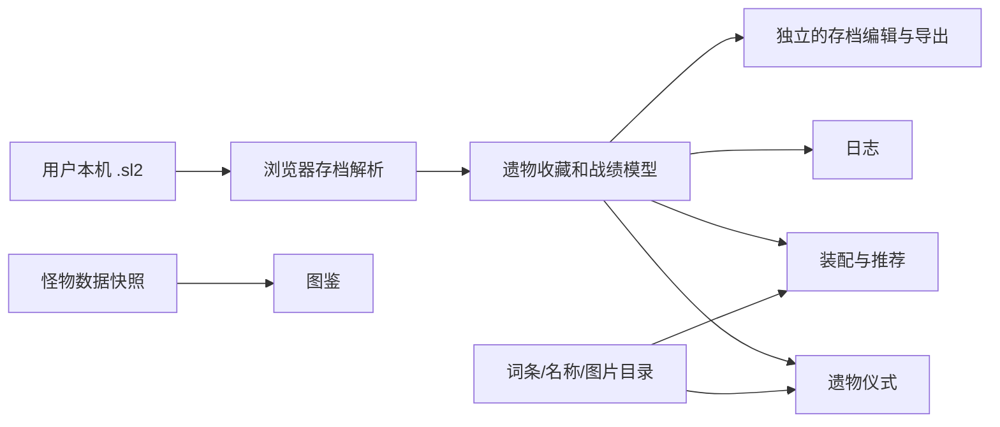

# 架构与模块边界

## 当前基线

`dist/index.html` 为单页入口，`dist/style.css` 和 `dist/game-ui.css` 负责样式；`dist/app.js` 组织页面、筛选、记录与装配交互。`dist/relic-parser.js` 在浏览器内解析存档；`dist/save-editor.js` 与 `dist/save-editor-ui.js` 包含编辑与导出路径；`dist/relic-optimizer.js` 负责组合计算。`dist/*.json` 是当前静态数据快照，图片在 `dist/relic-images/`、`dist/character-images/` 与 `dist/nav-icons/`。Sites 静态发布配置在 `.openai/hosting.json`。

这是**现状图**，不是对代码正确性的认定。重构须保留基线可回退，并先固定数据接口。

## 下一阶段的接口约定

- **存档模块**只输出已解析字段、原始 ID、来源偏移、置信状态和错误；不直接操作页面。
- **资料目录**提供稳定的遗物、词条、角色、器皿、怪物 ID 与中文显示名映射，并保存出处。无法映射时保留原始 ID。
- **配装模块**输入已拥有遗物、角色、器皿和流派规则；输出可解释的组合、槽位合法性、命中／缺失词条与得分明细，不修改原始收藏。
- **页面模块**只消费上述结果。存档解析失败与未知词条在 UI 上有显式状态。
- **存档编辑模块**独立于只读解析与推荐；只对已确认的格式版本启用，导出后重新解析并对比预期字段。

接口变更先更新数据字典和最小样例，再由依赖对话接入。不要一次性把静态网站改写为新框架；先解决可核对的数据错误和用户高频任务。

## 仓库与发布

GitHub `main` 是协作基线，功能通过独立分支和 PR 合并。Sites 现有来源仓库是部署目标，不能默认认为 GitHub 提交会自动上线。工程与发布对话应建立显式的“GitHub 提交 → Sites 版本 → 线上部署”步骤，并记录 Git SHA、数据快照版本和可回退版本；该发布链路在完成前不自动发布新功能。
